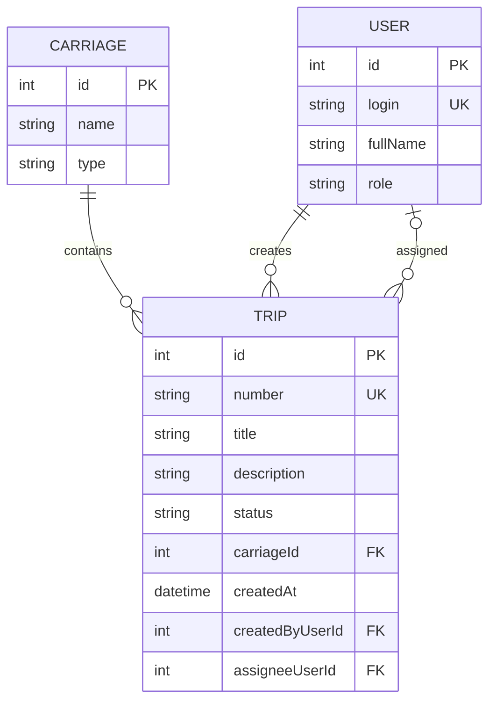

# Модель данных

## 1. Словарь проекта

| Термин курса | Термин моей темы |
|---|---|
| Trip | поездка (Trip) |
| Site | тип вагона (Carriage, справочник) |
| User | пассажир / проводник / администратор |

Предметная область — организация социального взаимодействия
попутчиков в поездах дальнего следования.

Главная сущность — поездка (Trip).
Справочник — типы вагонов (Carriage).

## 2. Сущности и поля

### 2.1. Carriage (справочник типов вагонов)

Таблица PostgreSQL: carriages.

| Поле модели | Поле БД | Тип БД | Ключ |
|---|---|---|---|
| id | id | integer | PK |
| name | name | varchar(50) | — |
| type | type | varchar(20) | — |

Описание полей:

- id — уникальный идентификатор типа вагона.
- name — название типа вагона.
- type — категория вагона.

Пример заполнения справочника:

| id | name | type |
|---|---|---|
| 1 | Плацкарт | economy |
| 2 | Купе | comfort |
| 3 | СВ | business |
| 4 | Тихий вагон | quiet |

Признак тихого вагона определяется по значению
type = 'quiet'. Отдельное поле isQuiet в базе
данных не хранится.

### 2.2. Trip (главный объект — поездка)

Таблица PostgreSQL: trips.

| Поле модели | Поле БД | Тип БД | Ключ |
|---|---|---|---|
| id | id | integer | PK |
| number | number | varchar(20) | UNIQUE |
| title | title | varchar(80) | — |
| description | description | varchar(500) | — |
| status | status | varchar(20) | — |
| carriageId | carriage_id | integer | FK -> Carriage.id |
| createdAt | created_at | timestamptz | — |
| createdByUserId | created_by_user_id | integer | FK -> User.id |
| assigneeUserId | assignee_user_id | integer, NULL | FK -> User.id |

Описание полей:

- id — уникальный машинный идентификатор поездки,
  генерируется автоматически.
- number — уникальный номер поездки длиной до 20 символов.
  Новые номера формируются автоматически, например
  TMP-08DF4D1FD6FD545A.
  например П-101.
- title — маршрут поездки, от 5 до 80 символов.
- description — описание поездки, от 10 до 500 символов.
- status — текущий статус поездки.
- carriageId — ссылка на тип вагона.
- createdAt — дата и время создания поездки.
- createdByUserId — идентификатор создателя поездки.
- assigneeUserId — идентификатор назначенного
  ответственного проводника.

Допустимые статусы:

| Статус | Значение |
|---|---|
| New | Новая |
| InProgress | В процессе |
| Closed | Завершена |
| Cancelled | Отменена |

При создании поездка получает статус New.
Ответственный проводник изначально не назначен,
поэтому assigneeUserId может быть null.

### 2.3. User (пользователь)

Таблица PostgreSQL: users.

| Поле модели | Поле БД | Тип БД | Ключ |
|---|---|---|---|
| id | id | integer | PK |
| login | login | varchar(50) | UNIQUE |
| fullName | full_name | varchar(200) | — |
| role | role | varchar(20) | — |

Описание полей:

- id — уникальный идентификатор пользователя.
- login — уникальный логин пользователя.
- fullName — полное имя пользователя.
- role — роль пользователя в системе.

Роли пользователей:

- passenger — пассажир.
- conductor — проводник.
- admin — администратор.

## 3. Связи

- Один тип вагона (Carriage) — много поездок (Trip).
- Один пользователь может создавать много поездок.
- Один пользователь может быть назначен ответственным
  на несколько поездок.
- У новой поездки ответственный может отсутствовать.
- Каждая поездка обязательно связана с одним типом вагона.
- Каждая поездка обязательно имеет создателя.

Все связи реализуются через внешние ключи.

### ER-диаграмма



## 4. Проверка 3НФ

Название и категория типа вагона хранятся в сущности
Carriage один раз.

Сущность Trip содержит внешний ключ carriageId,
который ссылается на Carriage.id.

При изменении названия типа вагона достаточно изменить
одну запись в справочнике. Название вагона не дублируется
в каждой поездке.

Информация о пользователях хранится отдельно в User.
Поездка содержит только ссылки на создателя
и назначенного ответственного.

Неключевые поля зависят от ключей соответствующих
сущностей. В рамках принятой модели отсутствуют
транзитивные зависимости между неключевыми полями.

Такая структура позволяет уменьшить дублирование
данных и избежать противоречий при их изменении.

## 5. Роли и права

Целевая модель разграничения прав:

| Роль | Создаёт | Назначает | Меняет статус |
|---|---|---|---|
| Пассажир | да | нет | отменяет свою поездку в статусе New |
| Проводник | нет | нет | да, только назначенную ему поездку |
| Администратор | нет | да | нет |

Проводник не может назначать себя самостоятельно.

Назначение ответственного выполняется отдельно
от изменения статуса поездки.

Допустимые переходы:

- New -> InProgress.
- InProgress -> Closed.
- New -> Cancelled.

Для перехода в InProgress необходимо назначить
ответственного проводника.

Статусы Closed и Cancelled являются конечными.

## 6. Соответствие программной реализации

Модель данных соответствует следующим файлам:

- backend/Models/Trip.cs
- backend/Models/Carriage.cs
- backend/Models/User.cs
- backend/Data/AppDbContext.cs
- db/schema.sql
- db/seed.sql
- db/queries.sql

В C# используются имена свойств в PascalCase,
в JSON — camelCase, в PostgreSQL — snake_case.

Например:

- C#: CarriageId.
- JSON: carriageId.
- PostgreSQL: carriage_id.

Проверка допустимых переходов статусов и наличия
назначенного проводника реализована в TripService.

Полноценное разграничение прав пользователей
является целевым требованием и требует дополнительной реализации.
```
